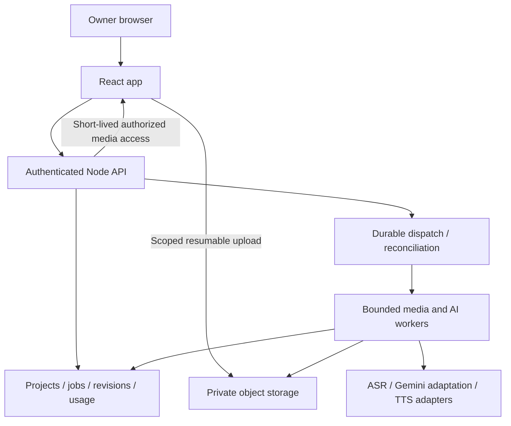

# 04 — Target architecture

**Status:** recommended architecture; services are not provisioned and choices need phase-0 approval.

## Recommended shape: modular app + durable media workers

Keep React/TypeScript and a Node API. Avoid both a monolithic browser demo and an unnecessary microservice fleet. Separate the API/control plane from resource-heavy media work.



## Proposed Google-oriented stack

| Responsibility | Recommendation | Rationale / gate |
|---|---|---|
| Development | Google AI Studio + repository checkpoints | Owner preference; verify import/sync and test access in actual account. |
| UI/API | React/Vite + Node/Express on Cloud Run service | Reuse familiar stack; short requests only. |
| Owner identity | Firebase Authentication, allowlisted owner UID | Private app without building passwords; backend verifies every token and ownership. |
| Durable metadata | Firestore via server | Low-operations start; entity-per-document, transactions for critical transitions. |
| Media | Private Cloud Storage | Objects separate from metadata and API payloads; signed/resumable access. |
| Workers | Containerized FFmpeg/FFprobe + Node on Cloud Run Jobs | Explicit media dependency and durable execution independent of the browser. |
| Dispatch | Cloud Tasks for short authenticated dispatch, job ledger + reconciler | Queue acceptance is not media completion. Validate job launch/retry semantics. |
| Secrets | Platform secrets for preview; managed secrets/workload identity in deployment | No client keys or static cloud credentials in code. |
| Monitoring | Structured logs + metrics/alerts | Job failures, stuck leases, storage/cost spikes. |

Cloud Tasks HTTP handlers have a maximum 30-minute dispatch deadline; long media work must not be a single Task HTTP request. [1](https://docs.cloud.google.com/tasks/docs/dual-overview) Cloud Run Jobs have separate task-timeout controls; verify resource and scratch-storage suitability in the actual chosen configuration, not just timeout limits. [1](https://docs.cloud.google.com/run/docs/configuring/task-timeout)

## Worker feasibility caveat

A 24-hour source can occupy tens or hundreds of GB. Never assume a container's writable filesystem is durable or sufficient. The spike must test bounded object reads, streaming/range access, seekable input strategy, muxing scratch needs, retries, and final output upload. If Cloud Run cannot meet measured memory/scratch/I/O requirements economically, use the **same worker contract** on a controlled VM with persistent disk. GPU source separation, if ever added, is a separate optional worker.

This is one designed fallback, not a commitment to deploy both architectures. Record the final choice in DEC-002.

## Data flow

1. API authorizes intake and creates asset/upload records.
2. Worker validates uploaded media, measures duration, creates audio/proxy artifacts.
3. API writes a job and durable dispatch intent together; dispatcher launches work idempotently.
4. Workers claim fenced attempts, call providers with bounded input, validate output, and commit immutable artifacts.
5. Owner approves revisions; downstream work consumes an immutable snapshot.
6. Render worker assembles only validated artifacts for the chosen source/range; QA succeeds before downloads become ready.

## Code boundaries — future layout, not a current restructure

```text
src/                 React features and shared UI
server/              API routes, auth, services, repositories
worker/              orchestration handlers, media operations, provider adapters
shared/              schemas, domain types, timebase, errors
prompts/             versioned production prompt templates and eval fixtures
tests/               unit, integration, media, browser and recovery tests
infra/               approved deployment configuration
```

Do not introduce a monorepo/package split until needed for packaging. Separate client/server build output. A frontend deployment must not expose server bundles.

## Alternatives consciously deferred

- PostgreSQL + Redis/BullMQ: valid if existing operations expertise justifies extra services; not necessary merely because jobs exist.
- Local-only app: simpler privacy/cost profile but contrary to the proposed hosted workflow; possible fallback only after owner decision.
- Browser FFmpeg/MediaRecorder: useful for small previews, not production long-form rendering.
- One day-long multimodal request: fragile cost/retry/timing behavior; explicitly rejected.

## Boundaries that must not blur

AI Studio is the development workspace, the Gemini API is a model service, and deployed API/storage/worker resources are production infrastructure. Being able to preview a full-stack app does not establish that its current container, storage, and quotas are suitable for marathon processing.

## v0.2: large-byte worker and preview decisions

The proposed source profile is up to 24 hours and 128 decimal GB per file, subject to separate approval and qualification (doc 23). Cloud Run's container contract states that its ordinary writable filesystem is memory-backed and nonpersistent; writing huge temporary sources there can exhaust instance memory. [2](https://docs.cloud.google.com/run/docs/container-contract)

Therefore TASK-003 must prove bounded ranged reads/seek behavior, transient output staging and actual resource peaks. Evaluate mounted/streaming storage behavior against the **specific runtime/version/configuration**; never infer POSIX disk semantics or unlimited space from a bucket mount. If needed, use the approved disk-backed worker alternative under the same job contract. The control-plane recommendation does not commit heavy media work to an unsuitable container.

Add a derived preview path with small/tiled artifacts, a publication-package service with source-to-part maps, and reference-aware lifecycle reconciliation. These are modules within the chosen app/worker system, not an automatic new microservice fleet. See docs 24/27/28/29.
